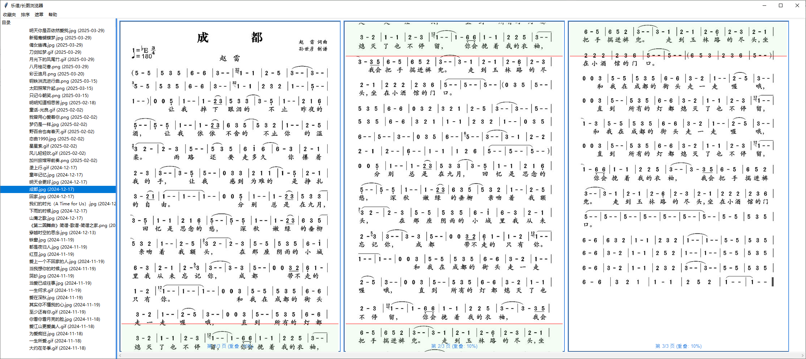

# Sheet Music and Long Image Viewer （乐谱/长图浏览器）

**Version: 1.2**

## 简介
**Sheet Music and Long Image Viewer（乐谱/长图浏览器）** 是一款专为浏览长图片（如乐谱、漫画、海报等）设计的工具。  
它能够将垂直方向超长的图像按设定的高度切割成多页并排展示，适用于演奏、超宽屏浏览等场景，提升查看长图的体验。

## 特性
- 支持超长图片（如钢琴谱、长漫画、学习资料）分段并排浏览
- 自定义切割比例
- 支持快速缩放查看
- 支持搜索当前文件夹及其子文件夹中的图片
- 记忆搜索结果窗口的大小和位置
- 按需生成可见页面，提升长图放大和滚动时的响应速度
- 明亮、专业的圆角界面与渐变画布背景
- 支持多种常见图片格式（JPG, PNG, BMP等）
- 适配超宽屏显示器

## 下载与使用
- 你可以在 [Releases 页面](https://github.com/Jimi-from-mars/Sheet-music-and-long-image-viewer/releases/latest) 下载最新版本的**编译程序（Windows版）**，无需安装，解压后直接运行。
- 岛主为大家准备了新手乐谱资源包，可在[岛主博客](https://phuketlord.top/archives/19.html)免费下载。解压后与本软件放在同一文件夹内即可（放其他任何地方也没有问题）。
- 如果希望参与热火朝天的讨论，可加入[电吹管讨论群](https://t.me/+qKoZM2j2JyQ0NGI9)。

### 运行方式
- **方式一**：下载编译版（推荐，适合普通用户）
- **方式二**：克隆本仓库，在本地 Python 环境中运行源代码

### 搜索图片
- 在顶部搜索栏输入文件名关键词，点击“搜索”或按回车键，即可搜索当前打开文件夹中的图片。
- 勾选“搜索子文件夹”后，会同时搜索当前文件夹下的所有子文件夹。
- 搜索结果使用相对于当前文件夹的路径显示，单击任意结果即可加载图片。
- 搜索结果窗口可自由移动和调整大小，程序会记住窗口上次关闭时的大小和位置；桌面分辨率改变导致原位置越界时，会自动回到默认位置。

## 版本更新日志

### v1.2
- 修复“整理收藏夹”窗口打开后内容空白的问题
- 全面优化亮色界面，按钮、菜单入口、搜索框及对话框采用圆角风格
- 画布使用薰衣草紫、柔白与暖桃色渐变背景，使页面和遮罩更易区分
- 搜索框获得焦点时，键盘输入不再触发图片缩放等全局操作
- 支持在搜索框中按回车键直接开始搜索

### v1.1
- 新增当前文件夹图片搜索功能，并支持递归搜索子文件夹
- 支持单击搜索结果直接加载图片
- 搜索结果窗口支持记忆大小和位置，并能在桌面分辨率变化后自动修正越界位置
- 优化长图缩放方式，按需生成可见页面并预加载相邻页面
- 合并连续缩放请求，减少放大图片时的界面卡顿

### v1.0
- 初版发布
- 支持超长图像分页浏览
- 支持图像缩放与拖拽
- 提供 Windows 版本可执行文件

## 界面展示

## 开发计划
- 增加节拍器功能

## 许可协议
本项目遵循 [MIT License](LICENSE) 开源许可协议。

## 贡献
欢迎提Issue和Pull Request！如果你有好的建议或希望加入开发，请联系我。
